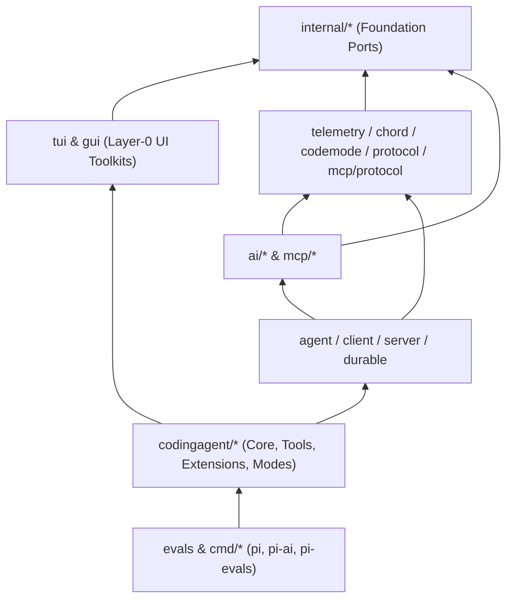

# pi-go Architecture

`pi-go` mirrors the modular layout of the Pi monorepo in a single Go module (`github.com/keejkrej/pi-go`) with strict acyclic package dependencies and pure-Go (`CGO_ENABLED=0`) compilation, maintaining byte-level compatibility with Pi `v1.5.2` on-disk state and wire formats.

## 1. Dependency Graph

- `cmd/pi` compiles cleanly under `CGO_ENABLED=0` for `darwin`, `linux`, and `windows`.
- Full-repo builds (`go build ./...`) target Unix hosts (`darwin`, `linux`) because `client` and `server/transports/unix` implement Unix domain socket transports.

## 2. Package Layers & Responsibilities

1. **Foundation ([`internal/`](../internal/))**:
   - JS/TS runtime semantics: [`internal/js`](../internal/js/) (UTF-16 string indexing, `LocaleCompare`, `TextDecoder`), [`internal/jsre`](../internal/jsre/) (ECMAScript regex via `regexp2`), [`internal/omap`](../internal/omap/) (insertion-ordered maps/sets), [`internal/jsonx`](../internal/jsonx/) (ordered JSON AST preserving key order and escaping).
   - Ecosystem utilities: [`internal/typebox`](../internal/typebox/) (JSON Schema validation & coercion), [`internal/quickjs`](../internal/quickjs/) (`wazero` WASI QuickJS guest VM), [`internal/jsdiff`](../internal/jsdiff/), [`internal/partialjson`](../internal/partialjson/), [`internal/ignore`](../internal/ignore/), [`internal/minimatch`](../internal/minimatch/), [`internal/semver`](../internal/semver/), [`internal/marked`](../internal/marked/), [`internal/mermaid`](../internal/mermaid/), [`internal/highlight`](../internal/highlight/), [`internal/eastasian`](../internal/eastasian/), [`internal/hostedgit`](../internal/hostedgit/), [`internal/lockfile`](../internal/lockfile/), [`internal/ansi`](../internal/ansi/), [`internal/sse`](../internal/sse/), [`internal/xspawn`](../internal/xspawn/).
2. **UI Toolkits & Core Primitives**:
   - [`tui`](../tui/): terminal rendering, raw mode, keyboard/mouse decoding, Markdown/image rendering, and reusable components (`vt` virtual terminal in tests).
   - [`gui`](../gui/): Layer-0 native GPU UI toolkit built on `github.com/egoist/mygo` (`mygo`, `ui`, `ui/markdown`, `ui/editor`), kept completely decoupled from agent, model, and session packages. See [Desktop GUI Architecture](gui.md).
   - [`telemetry`](../telemetry/), [`chord`](../chord/), [`codemode`](../codemode/), [`protocol`](../protocol/) (framing + byte-exact CBOR), [`mcp/protocol`](../mcp/protocol/).
3. **LLM, MCP, & Agent Runtime**:
   - [`ai`](../ai/), [`ai/api`](../ai/api/), [`ai/catalog`](../ai/catalog/), [`ai/oauth`](../ai/oauth/), [`ai/providers`](../ai/providers/), [`ai/compat`](../ai/compat/): model catalog, auth/OAuth store, and streaming LLM provider adapters.
   - [`mcp`](../mcp/) and [`mcp/oauth`](../mcp/oauth/): Model Context Protocol client and transports.
   - [`agent`](../agent/): turn loop (`AgentLoop` / `AgentLoopContinue`), sequential/parallel tool execution scheduling, and event stream accumulator.
   - [`client`](../client/), [`server`](../server/), [`durable`](../durable/): RPC/protocol client and server, plus durable execution harness with JSONL and SQLite (`modernc.org/sqlite`) backends.
4. **Application & Evals**:
   - [`codingagent`](../codingagent/): session manager, core tools (`read`, `write`, `edit`, `bash`, `grep`, `find`, `ls`), resource/skill/prompt loaders, package manager, compaction, HTML export, built-in and QuickJS extensions, experimental runtime, and execution modes.
   - [`evals`](../evals/) and [`cmd/*`](../cmd/): evaluation harness/suites and CLI binaries (`pi`, `pi-ai`, `pi-evals`, `pi-evals-entrypoint`).

## 3. Execution Modes (`codingagent`)

[`codingagent.Main`](../codingagent/main.go) parses CLI arguments via [`codingagent/core/args.go`](../codingagent/core/args.go) and dispatches to one of:

- **Interactive TUI** (`codingagent/modes/interactive`): default when stdin/stdout is a TTY.
- **Native Desktop GUI** (`codingagent/modes/gui`): launched via `--gui` or `--mode gui` (or `MainOptions.DefaultGuiMode`). See [Desktop GUI Architecture](gui.md).
- **Print & JSON modes** (`codingagent/modes`): non-interactive single-run or JSON-event stream output (`-p`/`--print`, `--mode text`, `--mode json`).
- **RPC mode** (`codingagent/modes/rpc`): line-delimited JSONL control protocol over stdin/stdout (`--mode rpc`).
- **Experimental modes** (`codingagent/experimental`, `codingagent/cli/experimentalcli`): durable agent/coordinator, services, plugins, and vacation commands.

## 4. Engineering Invariants

- **Pure Go (`CGO_ENABLED=0`)**: no `import "C"`; OS integration uses stdlib, `golang.org/x/sys`, or `github.com/ebitengine/purego` (for macOS frameworks/libobjc).
- **On-disk & wire compatibility**: configuration/session persistence uses [`internal/jsonx`](../internal/jsonx/) for deterministic key ordering and formatting, [`internal/lockfile`](../internal/lockfile/) for `proper-lockfile`-compatible locks, and [`protocol/cbor`](../protocol/cbor/) for byte-exact CBOR encoding. See [Porting Conventions](porting.md) (`§16`) for interop contracts.
- **Offline testability**: unit and integration tests avoid live network calls and real LLM credentials by using `FauxProvider` and `httptest.Server` / recorded fixtures. See [Development Guide](development.md).
- **Embedded assets**: [`codingagent/utils/config.go`](../codingagent/utils/config.go) embeds `codingagent/utils/assets` (`//go:embed all:assets`) so themes, HTML export templates, interactive images, and reference package docs/examples ship inside the binary.
- **Extensions**: see [Extensions & Package Manager](extensions.md) for built-in Go extensions and the QuickJS/WASI TS/JS extension host.
